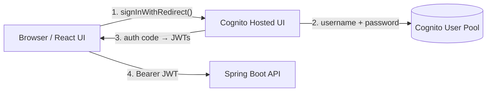
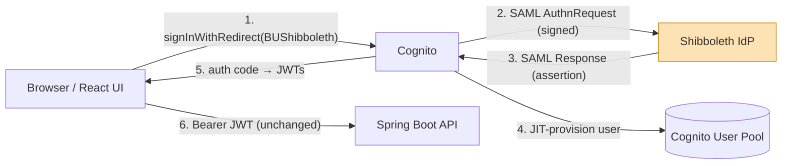
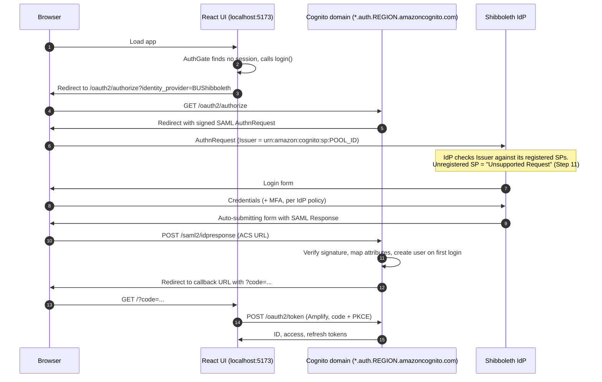
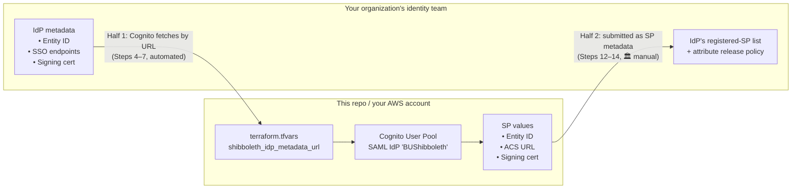
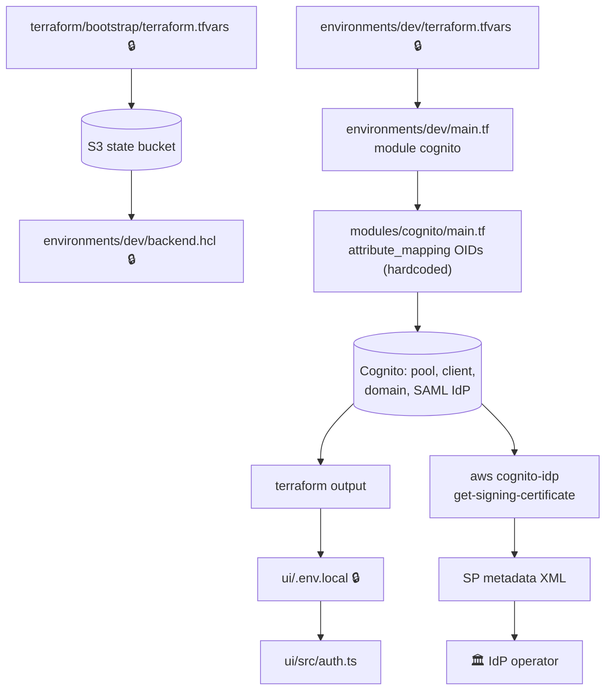
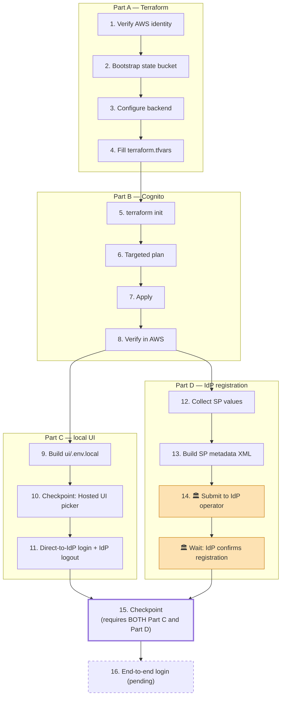

# Runbook: Deploying Cognito ↔ Shibboleth SAML Federation

Step-by-step guide for standing up **Cognito SAML federation** from a
fresh clone of this repo, against a Shibboleth IdP of your choosing.
The design rationale lives in [SHIBBOLETH-PLAN-3.md](SHIBBOLETH-PLAN-3.md).
This document is about *doing it*: what to configure, where, in what
order, and how to tell each step worked.

> **Coverage.** Steps 1–13 are verified end to end against a real dev
> account (through SHIBBOLETH-PLAN-3 §1.2, plus preparing the SP
> metadata for IdP registration). Steps 14–15 depend on the IdP
> operator's response. Step 16 onward is outlined but not yet verified. Steps that depend on your organization's IdP operator
> (marked **🏛 External**) contain placeholders to fill in.

---

## Contents

- [Background](#background)
  - [Who plays which role](#who-plays-which-role)
  - [How the login flow changes](#how-the-login-flow-changes)
  - [The two-way trust exchange](#the-two-way-trust-exchange)
  - [Where each setting lives](#where-each-setting-lives)
- [Prerequisites](#prerequisites)
- [Step overview](#step-overview)
- [Part A — AWS and Terraform foundation](#part-a--aws-and-terraform-foundation) (Steps 1–4)
- [Part B — Create Cognito and the SAML identity provider](#part-b--create-cognito-and-the-saml-identity-provider) (Steps 5–8)
- [Part C — Run the UI locally against Cognito](#part-c--run-the-ui-locally-against-cognito) (Steps 9–11)
- [Part D — Register Cognito with the IdP](#part-d--register-cognito-with-the-idp) (Steps 12–15)
- [Part E — Not yet verified](#part-e--not-yet-verified) (Steps 16+)
- [Troubleshooting](#troubleshooting)
- [Changing or removing the federation](#changing-or-removing-the-federation)

---

## Background

### Who plays which role

SAML has two parties: an **Identity Provider (IdP)**, which authenticates
users and vouches for them, and a **Service Provider (SP)**, which trusts
the IdP's assertions. In this design:

| SAML role | Who | Notes |
|---|---|---|
| IdP | Your Shibboleth IdP (e.g. `https://shib-test.bu.edu/idp/shibboleth`) | Owned by your organization's identity team, not this repo |
| SP | **AWS Cognito User Pool** | Not the React app, not the API |
| OAuth/OIDC client of Cognito | React UI (`ui/src/auth.ts`) | Unchanged protocol — still the OAuth authorization-code flow |
| JWT consumer | Spring Boot API | Unchanged — still validates Cognito-issued JWTs |

Consequences worth internalizing before starting:

- **No SAML code or key material lives in this repo.** Cognito generates
  and holds the SP signing keypair; the private key never leaves AWS.
  You only ever export the *public* certificate (Step 12).
- **The UI and API never see SAML.** They keep speaking OAuth/JWT to
  Cognito exactly as before. Federation is inserted *behind* Cognito.
- **Users are provisioned just-in-time.** The first successful Shibboleth
  login creates a Cognito user (status `EXTERNAL_PROVIDER`) — no
  invitations, no passwords.

### How the login flow changes

Before federation, Cognito authenticates the user itself:



After federation, Cognito delegates authentication to Shibboleth and
translates the SAML assertion into the same JWTs the app already
understands:



The full redirect sequence, in detail. Every arrow is a browser
redirect or form POST — the React app, Cognito, and the IdP never talk
to each other server-to-server, except Amplify's final token exchange:



### The two-way trust exchange

SAML trust has to be configured on **both** sides, and the two halves
are done by different people through different channels. This is the
main reason the setup can't be fully automated from this repo:



Until **both** halves are in place, the flow in the sequence diagram
stops at the IdP.

### Where each setting lives

Configuration is spread across tracked templates and gitignored
real-value files. This map shows how values flow from one to the next:



🔒 = gitignored; copy from the adjacent `*.example` file. Summary table:

| Setting | File | Tracked? | Value comes from |
|---|---|---|---|
| `expected_account_id`, `aws_region`, `state_bucket_name` | `terraform/bootstrap/terraform.tfvars` | No | You |
| `bucket` | `terraform/environments/dev/backend.hcl` | No | Bootstrap output `state_bucket_name` |
| Backend `region` | `terraform/environments/dev/backend.tf` | **Yes (hardcoded)** | Must equal the state bucket's region |
| `expected_account_id`, `aws_region`, `availability_zones` | `environments/dev/terraform.tfvars` | No | You |
| `cognito_hosted_ui_domain_prefix` | same | No | You (globally unique) |
| `cognito_callback_urls` | same | No | Where the UI runs (`http://localhost:5173/` locally) |
| `cognito_logout_urls` | same | No | Where the UI runs, **plus** the IdP's logout page (Step 4) |
| `shibboleth_idp_metadata_url` | same | No | 🏛 IdP operator |
| `shibboleth_require_signed_requests` | same | No | 🏛 IdP operator's policy |
| SAML attribute OIDs (`email`, `username`) | `terraform/modules/cognito/main.tf` | **Yes (hardcoded)** | 🏛 IdP's attribute release policy |
| IdP name `BUShibboleth` | `terraform/modules/cognito/main.tf` | **Yes (hardcoded)** | Fixed |
| `VITE_AWS_REGION`, `VITE_COGNITO_*` | `ui/.env.local` | No | `terraform output` |
| `VITE_COGNITO_IDENTITY_PROVIDER` | `ui/.env.local` | No | The IdP name above |

---

## Prerequisites

**Tools**

- Terraform ≥ 1.8 (see [terraform/README.md](../../terraform/README.md))
- AWS CLI v2, with a named profile for the target account
- Node.js + npm (for `ui/`)
- `jq` (used to extract the signing certificate)
- `curl` (to sanity-check the IdP metadata URL)

> **Windows / Git Bash note.** After installing Terraform with `winget`,
> an already-running VS Code (and every terminal it spawned) keeps the
> old `PATH`. Fully quit and restart VS Code, not just the terminal,
> before `terraform -version` will work.

**Access**

- IAM permissions to create Cognito resources and an S3 bucket in the
  target account.
- A Route 53 hosted zone, only if you set `api_domain_name` (not needed
  for the Cognito-only scope of this runbook).

**From your IdP operator (🏛 External — may take lead time, start early)**

- [ ] IdP metadata URL — `<!-- TODO: org-specific -->`
- [ ] Whether the IdP requires signed `AuthnRequest`s
- [ ] Which attributes the IdP will release, and their `urn:oid:` names
      (at minimum email and a stable unique identifier)
- [ ] The process/contact for registering a new SP — `<!-- TODO: org-specific -->`

---

## Step overview



After Step 8, Parts C and D can be worked **at the same time**. They
are not alternatives: Step 15 requires both. Start Part D first, since
waiting on the IdP operator is usually the longest delay. If
registration is confirmed before you reach Step 11, Step 11 goes
straight to the real IdP login form instead of "Unsupported Request".
In that case, continue directly to Step 16.

---

## Part A — AWS and Terraform foundation

### Step 1. Verify which AWS account you're targeting

Every Terraform command in this runbook acts on whatever account your
current credentials resolve to. Set the profile once per terminal and
confirm:

```bash
export AWS_PROFILE=<your-profile>
aws sts get-caller-identity
```

✅ The `Account` field is the account you intend to deploy to. You'll
put that same 12-digit ID into `expected_account_id` in Steps 2 and 4;
Terraform's provider then refuses to act on any other account.

### Step 2. Bootstrap the Terraform state bucket (once per AWS account)

Skip if a state bucket already exists in this account. Full background
is in [terraform/README.md §2](../../terraform/README.md#2-bootstrap-the-state-backend-once-per-aws-account).

```bash
cd terraform/bootstrap
cp terraform.tfvars.example terraform.tfvars
# edit: expected_account_id, aws_region, state_bucket_name
terraform init
terraform apply
terraform output state_bucket_name
```

Then move bootstrap's own state into that bucket so it isn't a single
local file:

```bash
cp backend.tf.example backend.tf
# edit: bucket = <state_bucket_name>, region = <the bucket's region>
terraform init -migrate-state
```

> ⚠️ `backend.tf.example` defaults `region` to `us-east-1`. If your
> bucket is elsewhere, change it — backend blocks can't read variables.

✅ `aws s3 ls s3://<state_bucket_name>/bootstrap/` lists `terraform.tfstate`.

### Step 3. Configure the environment's backend

```bash
cd ../environments/dev
cp backend.hcl.example backend.hcl
# edit: bucket = "<state_bucket_name>"
```

> ⚠️ The backend **region is hardcoded** in
> [backend.tf](../../terraform/environments/dev/backend.tf) (currently
> `us-east-2`). It must match the region of your state bucket. Either
> edit it, or add `region = "..."` to `backend.hcl` (values in
> `-backend-config` override the file).

### Step 4. Fill in `terraform.tfvars`

```bash
cp terraform.tfvars.example terraform.tfvars
```

The example file documents every variable. The ones that matter for
this runbook:

**Account and region** — get these consistent with each other, or
apply fails partway through:

```hcl
expected_account_id = "<12-digit ID from Step 1>"
aws_region          = "us-east-2"
availability_zones  = ["us-east-2a", "us-east-2b"]   # must belong to aws_region
```

**Cognito** — `manage_cognito = true` makes Terraform create and own the
User Pool:

```hcl
manage_cognito                  = true
cognito_hosted_ui_domain_prefix = "<globally-unique-prefix>"   # becomes <prefix>.auth.<region>.amazoncognito.com
cognito_callback_urls           = ["http://localhost:5173/"]
cognito_logout_urls             = ["http://localhost:5173/", "https://shib-test.bu.edu/idp/profile/Logout"]
```

The Hosted UI domain is required even though users will skip the
Hosted UI screens: it hosts the OAuth endpoints *and* the SAML ACS
endpoint (`/saml2/idpresponse`) the IdP posts back to. Callback URLs
must match the UI's origin **exactly**, including the trailing slash,
or Cognito rejects the redirect (`redirect_mismatch`).

`cognito_logout_urls` is an allow-list: Cognito's `/logout` endpoint
only redirects to a URL on it. It includes the IdP's logout page
(`https://<idp-host>/idp/profile/Logout`, the standard Shibboleth
path) so that Step 11 can end the user's **IdP** session on logout,
not just the Cognito one. Listing it here changes nothing by itself;
`VITE_COGNITO_LOGOUT_URL` chooses which entry the UI actually uses.

**Shibboleth** — setting the metadata URL is what causes the SAML
identity provider to be created at all (the resource is count-gated on
it being non-null):

```hcl
shibboleth_idp_metadata_url        = "<IdP metadata URL>"   # e.g. https://shib-test.bu.edu/idp/shibboleth
shibboleth_require_signed_requests = true
```

| Variable | Effect |
|---|---|
| `shibboleth_idp_metadata_url` | Cognito downloads the IdP's metadata (entity ID, SSO endpoints, signing cert) from this URL. Prefer the IdP's **test** instance for first setup. |
| `shibboleth_require_signed_requests` | Sets `RequestSigningAlgorithm = rsa-sha256`, so Cognito signs every `AuthnRequest` with its own managed key. Set to match the IdP's policy. |

Sanity-check the URL before applying — it should return SAML metadata
XML containing an `IDPSSODescriptor`:

```bash
curl -s "<IdP metadata URL>" | head -20
```

**Attribute mapping (hardcoded, review before applying).** The SAML
attribute names Cognito reads are in
[modules/cognito/main.tf](../../terraform/modules/cognito/main.tf), not
in tfvars:

```hcl
attribute_mapping = {
  email    = "urn:oid:0.9.2342.19200300.100.1.3"   # mail
  username = "urn:oid:1.3.6.1.4.1.5923.1.1.1.6"    # eduPersonPrincipalName
}
```

These are the standard eduPerson OIDs, but what matters is what *your*
IdP actually releases to this SP. Confirm with the IdP operator.

> ⚠️ Do **not** map to a `custom:*` attribute (e.g.
> `custom:entitlement`) unless the User Pool schema already defines it.
> Cognito rejects the mapping with `InvalidParameterException`, and
> custom attributes can only be added when a pool is **created**. Group
> sync via entitlements is deferred to Phase 2 for this reason.

---

## Part B — Create Cognito and the SAML identity provider

### Step 5. Initialize

```bash
cd terraform/environments/dev
terraform init -backend-config=backend.hcl
```

✅ "Terraform has been successfully initialized!" and no prompt to copy
existing state from elsewhere (if you see one, stop — you're probably
pointed at the wrong bucket/key).

### Step 6. Plan — targeted to Cognito only

The dev root module **unconditionally** creates a VPC, RDS, ECS, and an
ALB. None of that is needed to test authentication, and RDS in
particular takes time and costs money. Target just the Cognito module:

```bash
terraform plan -target=module.cognito -out=tfplan
terraform show -no-color tfplan > tfplan.txt   # -no-color avoids ANSI codes in the file
```

✅ The plan contains only `module.cognito[0].*` resources. On a first
run, expect:

| Resource | Purpose |
|---|---|
| `aws_cognito_user_pool.this` | The pool (has `prevent_destroy`) |
| `aws_cognito_user_pool_domain.hosted_ui[0]` | OAuth + SAML ACS endpoints |
| `aws_cognito_identity_provider.shibboleth[0]` | The SAML IdP, named `BUShibboleth` |
| `aws_cognito_user_pool_client.app` | SPA client; `supported_identity_providers = ["COGNITO", "BUShibboleth"]` |
| `aws_cognito_user_group.archive_attachment_viewer` | Attachment authorization group |

`"COGNITO"` stays in the client's provider list during transition so
native test accounts still work as a fallback.

### Step 7. Apply

```bash
terraform apply tfplan
```

Terraform will warn that `-target` produced a partial apply — that's
expected here.

> If apply fails on the identity provider with an `AttributeMapping`
> error, see Step 4's warning, fix the mapping, then re-run Steps 6–7.
> Resources created before the failure are kept in state; only the
> remainder is applied.

### Step 8. Verify in AWS

```bash
terraform output cognito_user_pool_id
POOL_ID=$(terraform output -raw cognito_user_pool_id)
REGION=<aws_region>

aws cognito-idp describe-identity-provider \
  --user-pool-id "$POOL_ID" --provider-name BUShibboleth --region "$REGION" \
  --query 'IdentityProvider.{type:ProviderType,details:ProviderDetails,mapping:AttributeMapping}'
```

✅ `ProviderType` is `SAML`, and `ProviderDetails` includes the
`MetadataURL` you set (and `RequestSigningAlgorithm` if signing is on).
If the URL was unreachable or not valid metadata, Cognito would have
rejected it during apply.

---

## Part C — Run the UI locally against Cognito

### Step 9. Build `ui/.env.local` from Terraform outputs

`auth.ts` validates its required `VITE_*` values **at module load**. If
any is missing, it throws before React renders anything — the symptom
is a completely **blank page** with the error only in the browser
console.

```bash
cd terraform/environments/dev
terraform output -raw cognito_user_pool_id
terraform output -raw cognito_client_id
terraform output -raw cognito_hosted_ui_domain
```

```bash
cd ../../../ui
cp .env.example .env.local
```

| `.env.local` key | Value |
|---|---|
| `VITE_AWS_REGION` | Your `aws_region` |
| `VITE_COGNITO_USER_POOL_ID` | `cognito_user_pool_id` (must start with `<region>_`) |
| `VITE_COGNITO_CLIENT_ID` | `cognito_client_id` |
| `VITE_COGNITO_DOMAIN` | `cognito_hosted_ui_domain` **without** `https://` |
| `VITE_COGNITO_REDIRECT_URL` | `http://localhost:5173/` (must match `cognito_callback_urls`) |
| `VITE_COGNITO_LOGOUT_URL` | `http://localhost:5173/` for now; Step 11 changes it (must match a `cognito_logout_urls` entry) |
| `VITE_COGNITO_IDENTITY_PROVIDER` | Leave **commented out** for now (Step 11) |

None of these are secrets — they're bundled into the public JS anyway.
No key or certificate ever goes in a `VITE_*` variable.

### Step 10. Checkpoint — Hosted UI shows both login options

```bash
npm install
npm run dev
```

Open `http://localhost:5173/`.

✅ You're redirected to Cognito's Hosted UI, which offers **both**
"Sign in with your email and password" and a **BUShibboleth** button.
This proves the pool, domain, client, callback URL, and IdP
registration on the Cognito side are all wired correctly — independent
of the IdP.

### Step 11. Enable direct-to-IdP login and IdP logout

In `ui/.env.local`, set these two together:

```
VITE_COGNITO_IDENTITY_PROVIDER=BUShibboleth
VITE_COGNITO_LOGOUT_URL=https://shib-test.bu.edu/idp/profile/Logout
```

`login()` in [auth.ts](../../ui/src/auth.ts) then calls
`signInWithRedirect({ provider: { custom: "BUShibboleth" } })`, which
adds `identity_provider=BUShibboleth` to the authorize URL and skips
the picker.

**Why the logout URL must change too.** Logging out clears the app's
tokens and Cognito's session, but not the user's session at the IdP.
With the picker gone, the app's sign-in check immediately sends the
logged-out user back to the IdP. The IdP still has a live session, so
it signs the user straight back in without a login form, and logout
appears to do nothing. Ending on the IdP's logout page ends that
session too. A redirect is needed because the IdP's metadata
advertises no SAML single-logout endpoint (see Step 13). The URL must
already be in `cognito_logout_urls` (Step 4), or Cognito refuses the
logout.

Because this URL is on a different site from the app, `logout()`
passes it to Amplify's `signOut()` explicitly as
`oauth: { redirectUrl }`. Without that, Amplify throws
`InvalidOriginException` and the first logout click does nothing.

**Restart `npm run dev`** — Vite reads env files only at startup.

✅ Visiting `http://localhost:5173/` goes straight to the IdP's page.
Until Part D is complete, expect the IdP to refuse the request (at BU:
*"Web Login Service – Unsupported Request"*). That error is a success
signal at this stage: Cognito built and sent a valid `AuthnRequest`;
the IdP just doesn't recognize the SP yet.

To bring the picker back (useful for native Cognito test accounts),
comment out `VITE_COGNITO_IDENTITY_PROVIDER`, set
`VITE_COGNITO_LOGOUT_URL` back to `http://localhost:5173/`, and
restart.

---

## Part D — Register Cognito with the IdP

### Step 12. Collect the three SP values

The IdP operator needs exactly three facts about Cognito. All are
derived from the pool ID and Hosted UI domain:

| SP value | Format | Example (dev) |
|---|---|---|
| Entity ID | `urn:amazon:cognito:sp:<POOL_ID>` | `urn:amazon:cognito:sp:us-east-2_YeNYsPvBL` |
| ACS URL (HTTP-POST) | `https://<cognito_hosted_ui_domain>/saml2/idpresponse` | `https://kuali-archive-dev-7k2m9x.auth.us-east-2.amazoncognito.com/saml2/idpresponse` |
| Signing certificate | Base64 X.509 from the CLI below | — |

```bash
aws cognito-idp get-signing-certificate \
  --user-pool-id "$POOL_ID" --region "$REGION" | jq -r '.Certificate'
```

This prints only the **public** certificate. Cognito uses the matching
private key to sign `AuthnRequest`s; the IdP uses this cert to verify
them.

> ⚠️ All three values are tied to the User Pool. If the pool is ever
> **recreated** (e.g. to add a custom schema attribute in Phase 2), the
> Entity ID and certificate change and the IdP registration must be
> redone. Changing `cognito_hosted_ui_domain_prefix` changes the ACS URL.

### Step 13. Build the SP metadata document

Most Shibboleth operators prefer a SAML metadata XML file over loose
values. A worked example for dev is
[samlMetaKualiArchive-cognito.xml](../../terraform/environments/dev/samlMetaKualiArchive-cognito.xml),
adapted from a generic Shibboleth-SP template
([samlMetaKualiArchive.xml](../../terraform/environments/dev/samlMetaKualiArchive.xml)).
To produce one for another pool, copy it and replace:

1. `entityID` on `<md:EntityDescriptor>` → Entity ID from Step 12
2. `<ds:X509SubjectName>` → `CN=<POOL_ID>`
3. `<ds:X509Certificate>` body → certificate from Step 12
4. `Location` on `<md:AssertionConsumerService>` → ACS URL from Step 12

**Why the worked example is shorter than the template.** The template
describes a native Shibboleth SP, which supports many bindings and
endpoints. Cognito supports only one ACS endpoint (HTTP-POST to
`/saml2/idpresponse`), so the other ACS entries, artifact resolution,
and discovery entries were removed. Advertising endpoints Cognito
doesn't implement would invite the IdP to use them.

**Open items to settle with the IdP operator:**

- **NameID format.** The example requests `emailAddress`, with
  `unspecified` commented out as a fallback. Use whatever the IdP
  releases; Cognito's own user identity comes from `attribute_mapping`.
- **Single logout.** BU's test IdP metadata advertises no
  `SingleLogoutService`, so SAML single logout isn't available, and
  the module's `IDPSignout = "true"` has no effect. IdP-side logout is
  done instead by redirecting to the IdP's logout page (Steps 4 and
  11). That's why the example SP metadata declares no
  `SingleLogoutService` either. If another IdP does support single
  logout, ask whether it needs Cognito's logout endpoint
  (`https://<domain>/saml2/logout`) registered.

### Step 14. 🏛 Submit the SP registration to the IdP operator

> **Placeholder — fill in for your organization.**
>
> - **Who/where:** `<!-- TODO: team, ticket queue, or form URL -->`
> - **Which IdP:** test (`<!-- TODO -->`) vs production (`<!-- TODO -->`).
>   Register against test first; production usually needs a separate request.
> - **Attach:** the SP metadata XML from Step 13.
> - **Request attribute release** for this SP:
>   - [ ] `mail` (`urn:oid:0.9.2342.19200300.100.1.3`)
>   - [ ] `eduPersonPrincipalName` (`urn:oid:1.3.6.1.4.1.5923.1.1.1.6`)
>   - [ ] (Phase 2) `eduPersonEntitlement` (`urn:oid:1.3.6.1.4.1.5923.1.1.1.7`)
>         or the org's equivalent group/role attribute — `<!-- TODO -->`
> - **Confirm** signed `AuthnRequest`s with RSA-SHA256 are accepted.
> - **Confirm** NameID format and single-logout expectations (Step 13).
> - **Typical turnaround / approvals:** `<!-- TODO -->`
> - **Required justification / data classification / sponsor:** `<!-- TODO -->`

Record the ticket/reference number here or in your session notes.

### Step 15. Checkpoint — both branches complete

This is where Parts C and D join. Don't proceed to Step 16 until
**all** of the following are true:

- ✅ Cognito pool, domain, app client, and `BUShibboleth` SAML IdP exist
  and are wired together (Steps 8, 10)
- ✅ The UI sends users directly to the IdP with a Cognito-built
  `AuthnRequest` (Step 11)
- ✅ The IdP operator has **confirmed** the SP registration and
  attribute release (Step 14). Submitting the request isn't enough.

---

## Part E — Not yet verified

These steps follow SHIBBOLETH-PLAN-3 but have **not** yet been run
end to end. Treat them as an outline until verified.

### Step 16. End-to-end login (after IdP registration)

1. With `VITE_COGNITO_IDENTITY_PROVIDER=BUShibboleth`, visit
   `http://localhost:5173/`.
2. ✅ The IdP shows its real login form (not "Unsupported Request").
3. Authenticate with a real org credential.
4. ✅ The browser returns to `http://localhost:5173/` with a Cognito
   session.
5. ✅ A Cognito user was created just-in-time:
   ```bash
   aws cognito-idp list-users --user-pool-id "$POOL_ID" --region "$REGION" \
     --query 'Users[].{user:Username,status:UserStatus}'
   ```
   Expect `UserStatus: EXTERNAL_PROVIDER` and a username prefixed with
   `BUShibboleth_`.
6. The dashboard needs `GET /api/dashboard`. Without a running API, it
   shows an error alert even though login succeeded — see Step 18.
7. Click logout **once**.
   ✅ The browser lands on the IdP's "logout operation is complete" page.
8. Visit `http://localhost:5173/` again.
   ✅ The IdP shows its login form, instead of silently signing you
   back in.

### Step 17. Local-dev auth bypass (SHIBBOLETH-PLAN-3 §1.3)

*Not yet implemented.* Adds `VITE_AUTH_REQUIRED` (default `true`) so
`AuthGate.tsx` can skip login for UI-only work. `<!-- TODO: steps once implemented -->`

### Step 18. Mock dashboard stub (SHIBBOLETH-PLAN-3 §1.7, optional)

*Not yet implemented.* Lets Step 16 reach a rendered landing page
without the API or Postgres. `<!-- TODO: steps once implemented -->`

### Step 19. Group sync (SHIBBOLETH-PLAN-3 Phase 2)

*Not yet started.* Requires a User Pool schema attribute for
entitlements. That forces **pool replacement**, which invalidates the
Step 14 registration (see Step 12's warning) and requires temporarily
lifting `prevent_destroy`. Plan that change and the re-registration
together. `<!-- TODO -->`

### Step 20. Deployed (non-localhost) environments

`<!-- TODO -->` At minimum:

- Add the deployed UI origin to `cognito_callback_urls`.
- Add the production IdP's logout page to `cognito_logout_urls`, and
  set the `ui_logout_url` tfvar to it. That tfvar already feeds
  `VITE_COGNITO_LOGOUT_URL` into the Amplify build.
- Pass `VITE_COGNITO_IDENTITY_PROVIDER` into the Amplify build
  environment. Terraform's `module "amplify"` block doesn't do this yet.
- Register against the production IdP (separate 🏛 request).

---

## Troubleshooting

| Symptom | Cause | Fix |
|---|---|---|
| `terraform: command not found` right after `winget install` | VS Code inherited the old `PATH` | Fully restart VS Code |
| Plan/apply fails on subnets or AZs | `availability_zones` don't belong to `aws_region` | Make them match (Step 4) |
| `init` asks to copy state, or can't find the bucket | Wrong `bucket` in `backend.hcl` or wrong `region` in `backend.tf` | Step 3 |
| `InvalidParameterException: AttributeMapping contains invalid mapping: [custom:...]` | Mapped to a custom attribute not in the pool schema | Remove the mapping (Step 4) |
| `tfplan.txt` is full of `[0m`-style junk | ANSI color codes | `terraform show -no-color` |
| Blank white page at `localhost:5173` | Missing/empty `VITE_*` value; `auth.ts` threw at load | Check browser console; complete `.env.local` (Step 9) |
| Changed `.env.local` but nothing changed | Vite reads env only at startup | Restart `npm run dev` |
| Cognito error `redirect_mismatch` | `VITE_COGNITO_REDIRECT_URL` ≠ a `cognito_callback_urls` entry | Make them identical, including the trailing slash |
| IdP: "Unsupported Request" (or similar) | SP not registered at the IdP yet, or registered with stale Entity ID/ACS | Steps 12–14; re-check after any pool or domain change |
| Hosted UI shows no BUShibboleth button | IdP not in client's `supported_identity_providers` | Check that `shibboleth_idp_metadata_url` is set, then re-plan |
| Logout returns you to the app, still signed in | The IdP session survived logout, so the app signed you straight back in | Point `VITE_COGNITO_LOGOUT_URL` at the IdP's logout page (Step 11) |
| First logout click does nothing; console shows `InvalidOriginException` | Amplify rejects a sign-out URL on another site unless it's passed explicitly | `logout()` must call `signOut({ ..., oauth: { redirectUrl } })` (Step 11) |
| Cognito error page on logout instead of a redirect | `VITE_COGNITO_LOGOUT_URL` isn't in `cognito_logout_urls` | Add it to the tfvars list and apply (Step 4) |

---

## Changing or removing the federation

- **Point at a different IdP:** change `shibboleth_idp_metadata_url`,
  re-run Steps 6–8, then repeat Part D with the new IdP's operator.
  The SP values don't change.
- **Remove federation:** set `shibboleth_idp_metadata_url = null` (or
  remove it) and re-apply. The SAML IdP is destroyed and the client
  reverts to `["COGNITO"]`. Comment out `VITE_COGNITO_IDENTITY_PROVIDER`,
  set `VITE_COGNITO_LOGOUT_URL` back to the UI's own URL, and drop the
  IdP logout page from `cognito_logout_urls`.
- **The User Pool itself** has `prevent_destroy = true`. Destroying or
  replacing it is deliberately hard. See the comment in
  [modules/cognito/main.tf](../../terraform/modules/cognito/main.tf).
